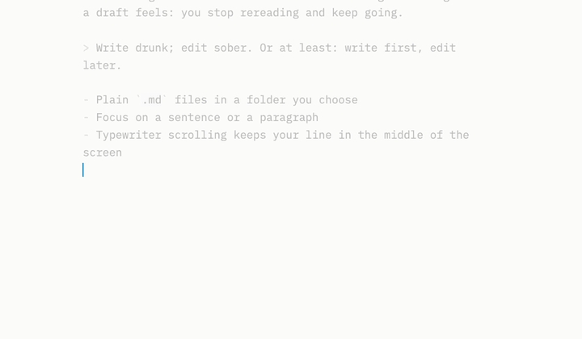
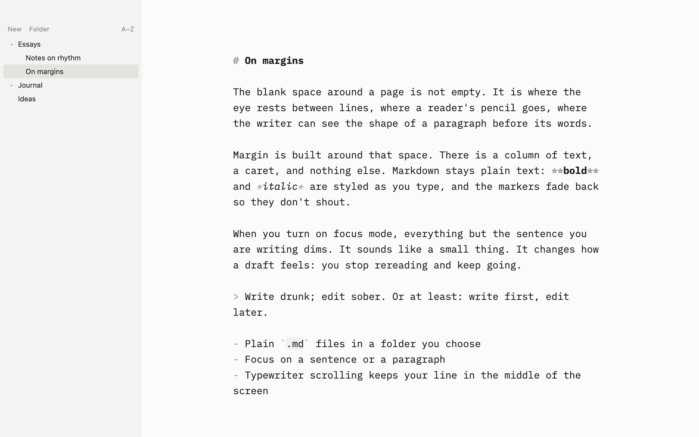
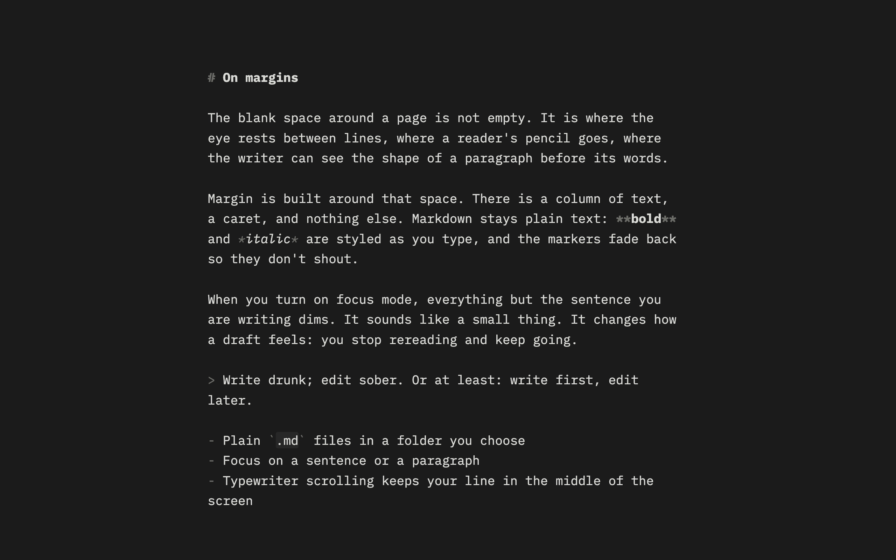
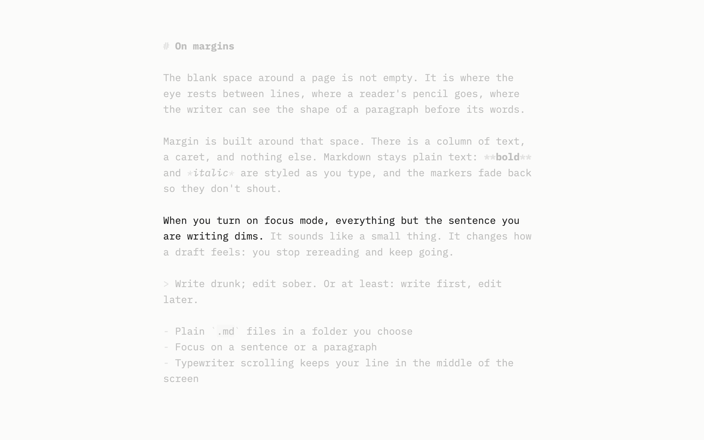
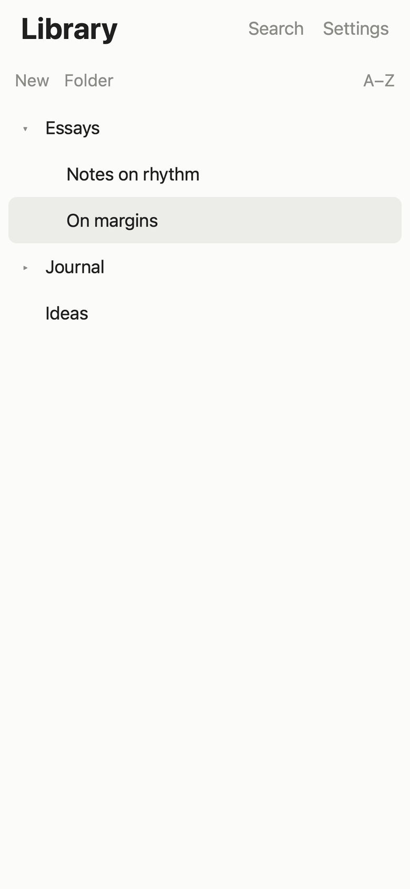
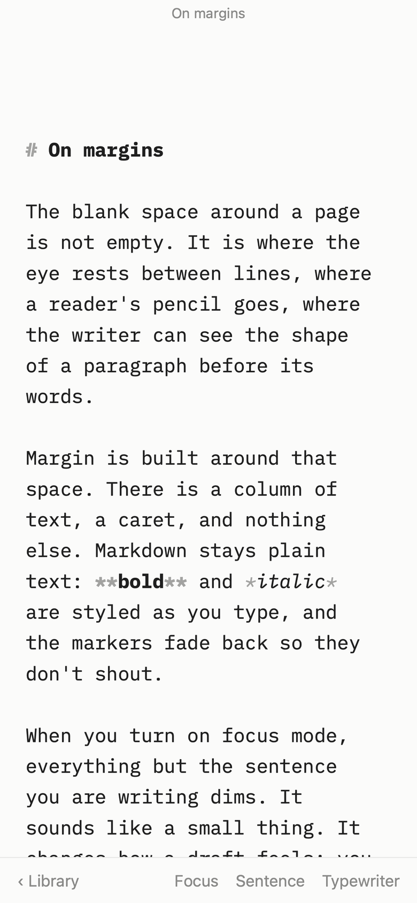
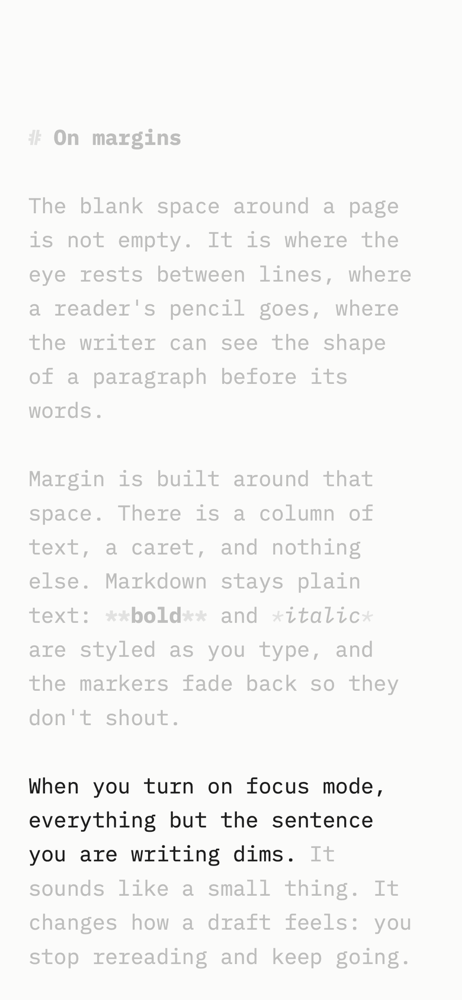
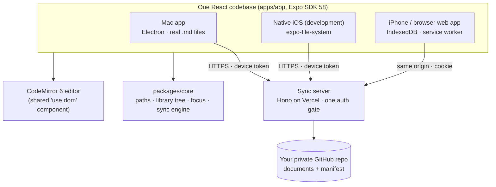

<p align="center">
  
</p>
<p align="center">
  
  
</p>

<p align="center"><strong>A quiet place to write.</strong><br>Plain markdown files, a focus mode that dims everything but your sentence, and sync on a server you own.</p>

<p align="center">
  <a href="LICENSE"></a>
  
  
  
  <a href="docs/decisions/"></a>
</p>

<p align="center">
  <a href="#features">Features</a> ·
  <a href="#screenshots">Screenshots</a> ·
  <a href="#install">Install</a> ·
  <a href="#self-host-the-sync-server">Self-host</a> ·
  <a href="#architecture">Architecture</a> ·
  <a href="#contributing">Contributing</a>
</p>

<p align="center">
  
  
</p>

## Features

<table>
<tr>
<td width="33%" valign="top">

**◐ Focus mode**<br>
Hides every bit of chrome and dims all but the sentence (or paragraph) you're writing. Typewriter scrolling keeps your line in the middle of the screen.

</td>
<td width="33%" valign="top">

**Plain files**<br>
Every document is a `.md` file in an ordinary folder (`~/Documents/Margin`). Use Finder, git or any other editor alongside; Margin notices.

</td>
<td width="33%" valign="top">

**Never loses text**<br>
Every keystroke is saved within a moment and before quitting, writes are atomic, and a clash keeps both versions as a conflict copy ([ADR 0006](docs/decisions/0006-save-pipeline.md)).

</td>
</tr>
<tr>
<td valign="top">

**Library**<br>
Folders, quick open (⌘P), rename and drag-to-move, Trash or Recently Deleted. Markdown is styled as you type, in IBM Plex Mono.

</td>
<td valign="top">

**Sync on your own server**<br>
Optional. Sign in with GitHub to a small server on Vercel's free tier; documents live in your own private GitHub repo. Works offline.

</td>
<td valign="top">

**Private by design**<br>
Only allowlisted GitHub accounts can sign in, every device has its own revocable token, and there are no analytics. Your documents are stored only on your devices and in your repo.

</td>
</tr>
</table>

### Focus mode

Type, and the highlight follows the sentence you're in; everything else rests in the margin.

<p align="center"></p>

<details>
<summary><b>Keyboard shortcuts (macOS)</b></summary>

| | |
|---|---|
| New document / folder | ⌘N / ⇧⌘N |
| Quick open | ⌘P |
| Show library | ⌘\ |
| Focus mode | ⇧⌘F |
| Focus on sentence / paragraph / nothing | ⌥⌘1 / ⌥⌘2 / ⌥⌘0 |
| Typewriter scrolling | ⌥⌘T |
| Full screen | ⌃⌘F |
| Sync now | ⌥⌘S |
| Library keyboard | ↑/↓, →/← expand/collapse, Enter open, F2 rename |

On iPhone, the bar above the keyboard has Focus, the focus scope and Typewriter.
</details>

## Screenshots

| Mac | Mac, dark | Mac, focus mode |
|:-:|:-:|:-:|
|  |  |  |

| iPhone library | iPhone editor | iPhone, focus mode |
|:-:|:-:|:-:|
|  |  |  |

## Install

Margin is a personal project, built milestone by milestone ([ROADMAP.md](ROADMAP.md)). The Mac app, the iPhone web app and the sync server are in daily use.

### On your Mac
Build it (see [Run it locally](#run-it-locally)), then open `apps/desktop/release/mac-arm64/Margin.app`, or make a `.dmg` with `pnpm --filter @margin/desktop package`. Builds are **unsigned** (signing needs a paid Apple account; [ADR 0019](docs/decisions/0019-mobile-pwa.md)). The first time, right-click Margin.app → **Open**, or use System Settings › Privacy & Security › **Open Anyway**.

### On your iPhone
Margin on iPhone is a web app served by your sync server: free, offline-capable, with its own icon ([ADR 0020](docs/decisions/0020-hosted-web-app.md)).
1. In **Safari**, open your server (e.g. `https://margin-sync.vercel.app`) and **Sign in with GitHub**.
2. **Share → Add to Home Screen → Add.**
3. Open Margin from the new icon and sign in once more. That's the session the installed app keeps.

The full guide and checklist: [docs/ios-testing.md](docs/ios-testing.md).

## Run it locally

**Prerequisites:** macOS (for the desktop app), Node.js 22+, pnpm 10 (`corepack enable`). No Xcode, Rust or Apple account needed.

```sh
git clone https://github.com/lyonsv/writing.git margin
cd margin
pnpm install
pnpm dev:desktop      # Electron + the Expo web dev server, on a separate "Margin Dev" library
```

<details>
<summary><b>Everything you can run</b></summary>

| Run | Command |
|---|---|
| Desktop app (development) | `pnpm dev:desktop`: the Expo web dev server (port 8081) plus Electron. Uses a separate `~/Documents/Margin Dev` library and `~/Library/Application Support/Margin Dev` settings, never your real `~/Documents/Margin`; override with `MARGIN_LIBRARY_DIR` / `MARGIN_USER_DATA_DIR`. |
| Packaged desktop app | `pnpm build:desktop`, then open `apps/desktop/release/mac-arm64/Margin.app`. |
| Browser (no sync) | `pnpm dev:web`, then open http://localhost:8081 (documents in IndexedDB). |
| The web app with sync | `pnpm build:web && pnpm dev:server`, then open http://127.0.0.1:3000 and sign in (as on iPhone). |
| Native iOS app (development) | `pnpm --filter @margin/app start` and scan the QR code with Expo Go ([docs/ios-testing.md](docs/ios-testing.md)). |
| Sync server | `pnpm dev:server` (http://127.0.0.1:3000, in-memory store). Needs `apps/server/.env.local`, see below. |
| Checks | `pnpm typecheck && pnpm test`; end to end (desktop app + web app in WebKit): `npx playwright install webkit` once, then `pnpm build:desktop && pnpm test:e2e && pnpm verify:packaged`. |
| README images | `pnpm docs:screenshots` regenerates everything in `docs/images/`. `pnpm brand:build` regenerates the logo and icons. |

Development builds talk to `http://127.0.0.1:3000`; the packaged app to `https://margin-sync.vercel.app`. Point either elsewhere with `MARGIN_SERVER_URL` (desktop) or Settings › Server (native iOS).
</details>

<details>
<summary><b>A local sync server</b></summary>

1. Create a GitHub OAuth App (GitHub › Settings › Developer settings › OAuth Apps) with callback `http://127.0.0.1:3000/api/auth/github/callback`.
2. Write `apps/server/.env.local` (git-ignored):
   ```sh
   PUBLIC_URL=http://127.0.0.1:3000
   GITHUB_CLIENT_ID=<client id>
   GITHUB_CLIENT_SECRET=<client secret>
   ALLOWED_GITHUB_LOGINS=<your login>:<your numeric GitHub id>   # curl -s https://api.github.com/users/<login> | grep '"id"'
   AUTH_SECRET=<output of: openssl rand -base64 48>
   MARGIN_STORE=memory
   ```
3. `pnpm dev:server`, then `pnpm dev:desktop` and Margin › Sign In…
</details>

## Self-host the sync server

The server is a small Hono app (`apps/server`) on Vercel Functions. It stores your documents in a **private GitHub repository you own** ([ADR 0021](docs/decisions/0021-github-storage.md)): versioned, and a backup by construction. One person fits comfortably in Vercel's free Hobby plan and a free private repo. The full walkthrough is [docs/server-setup.md](docs/server-setup.md); in short:

1. **Vercel project:** `npx vercel@latest link` at the repo root, with Root Directory `apps/server`, framework Hono and Node 24 ([ADR 0014](docs/decisions/0014-vercel-deploy.md)).
2. **Storage repo:** a **private** repo (e.g. `margin-library`) with `main` and `preview` branches, plus a **fine-grained token for that repo only** (Contents: read and write). Set `MARGIN_STORE=github`, `GITHUB_STORE_TOKEN`, `GITHUB_STORE_REPO` and `GITHUB_STORE_BRANCH` (`main` for Production, `preview` for Preview), and `PRODUCTION_GITHUB_STORE=<you>/margin-library@main` for Preview, so a preview can never touch your real documents.
3. **GitHub OAuth App** for production, with callback `https://<your-domain>/api/auth/github/callback`.
4. **Environment variables** (in Vercel only): `GITHUB_CLIENT_ID`, `GITHUB_CLIENT_SECRET`, `ALLOWED_GITHUB_LOGINS` (`login:id`), `AUTH_SECRET` (different per environment) and `PUBLIC_URL`. See [.env.example](.env.example). If anything is missing, the server refuses every request rather than run half-configured.
5. **Deploy** with `npx vercel@latest deploy --prod`, then run `pnpm --filter @margin/server smoke https://<your-domain>`. Your server now also serves the iPhone/browser app at `/`, behind sign-in.

## Architecture



- The Mac app is Electron hosting the Expo **web** export. The iPhone web app is the same export served by your server. The native iOS app runs it natively, with the editor in a WebView ([ADRs 0002](docs/decisions/0002-electron-shell-over-expo-web.md), [0003](docs/decisions/0003-codemirror-dom-component.md)).
- Shared logic is plain TypeScript in `packages/core`, tested with Vitest; the three-way sync engine keeps both versions on conflict ([ADR 0013](docs/decisions/0013-sync.md)).
- Every design decision is an ADR in [docs/decisions/](docs/decisions/).

## Contributing

Issues and pull requests are welcome; it's a small, opinionated app, so please open an issue before anything large. Start with [AGENTS.md](AGENTS.md), the working guide for contributors (human or AI): commands, layout, the rules that keep text safe, and the checks to run before pushing. [ROADMAP.md](ROADMAP.md) shows what's done and what's next.

<details>
<summary><b>Troubleshooting</b></summary>

- **"Margin can't be opened because Apple cannot check it…":** the build is unsigned. Right-click → Open, or System Settings › Privacy & Security › Open Anyway.
- **`pnpm install` warns about Node 24 for `apps/server`:** harmless on Node 22/23 locally; Vercel runs Node 24.
- **The desktop app shows a blank window in development:** wait for the Expo dev server on :8081 (`pnpm dev:desktop` starts it).
- **Port 8081 already in use:** `pnpm dev:web`, `pnpm dev:desktop` and `pnpm --filter @margin/app start` all use Metro on 8081. Run one at a time, or `MARGIN_DEV_PORT=8082 pnpm dev:desktop`.
- **End-to-end tests test old code:** they run the *built* app. Rebuild with `pnpm build:desktop` after changing `apps/app` or `apps/desktop`.
- **Sign-in says "Invalid sign-in request":** the server URL, the OAuth App's callback and `PUBLIC_URL` must match exactly (use `127.0.0.1`, not `localhost`).
- **"Sync error: the server's copy … is older":** see [docs/sync-recovery.md](docs/sync-recovery.md). Nothing was changed on your Mac.
- **"Sync paused — retrying in N s":** the server asked clients to slow down (GitHub's rate limits); Margin waits and continues on its own.
- **Native iOS in Expo Go can't sign in:** development builds default to `127.0.0.1:3000`, which is the phone itself. Pick a server in Settings › Server; see [docs/ios-testing.md](docs/ios-testing.md).
</details>

## Licence

Margin is released under the [MIT License](LICENSE). It bundles **IBM Plex Mono** (© IBM Corp., SIL Open Font License 1.1); that and every other third-party licence are in [THIRD_PARTY_NOTICES.md](THIRD_PARTY_NOTICES.md). The Margin name and logo ([assets/brand](assets/brand), [ADR 0018](docs/decisions/0018-brand.md)) are original; Margin isn't affiliated with any other writing app.
