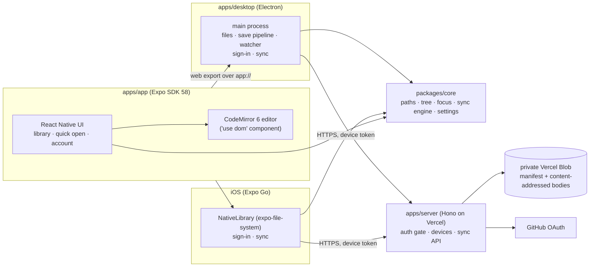

<p align="center">
  
  
</p>

**Margin is a quiet place to write.** It's a distraction-free markdown editor for macOS (and, in development, iOS) that keeps your words in plain `.md` files in a folder you choose. Focus mode dims everything but the sentence you're writing. If you want, it syncs your documents between devices through a small server you host yourself on Vercel's free tier, and only you can sign in to it.


| Focus mode (sentence) | Dark |
|---|---|
|  |  |

## Features
- **Plain files:** every document is a `.md` file in an ordinary folder (`~/Documents/Margin` by default). Use Finder, git or any other editor alongside Margin; it notices outside changes.
- **Markdown, styled quietly:** headings, bold, italic, code, quotes and lists are styled as you type, and the markers fade back. Written in IBM Plex Mono at a comfortable measure.
- **Focus mode:** hides all chrome and dims everything but the current sentence or paragraph. **Typewriter scrolling** keeps your line in the middle of the screen.
- **Library:** folders, quick open, rename and move (drag and drop), Trash. New documents are named by date.
- **Never loses text:** every keystroke is saved within a moment and before quitting; writes are atomic; if a file changed elsewhere, your version is kept as a conflict copy rather than overwriting it ([ADR 0006](docs/decisions/0006-save-pipeline.md)).
- **Optional sync:** sign in with GitHub to your own server. Edits from two devices are both kept. Works offline.
- **Private by design:** single-user allowlist (GitHub login and numeric id), per-device revocable tokens, private Blob storage, no analytics.

### Keyboard shortcuts (macOS)

| | |
|---|---|
| New document / folder | ⌘N / ⇧⌘N |
| Quick open | ⌘P |
| Show library | ⌘\ |
| Focus mode | ⇧⌘F |
| Focus on sentence / paragraph / nothing | ⌥⌘1 / ⌥⌘2 / ⌥⌘0 |
| Typewriter scrolling | ⌥⌘T |
| Full screen | ⌃⌘F |
| Sync now | ⌥⌘S |
| Library keyboard | ↑/↓, →/← expand/collapse, Enter open, F2 rename |

## Status
Margin is a personal project, built milestone by milestone ([ROADMAP.md](ROADMAP.md)). The **macOS app** and the **sync server** are in daily use. On **iPhone**, the plan is an installable web app (in progress, [ADR 0019](docs/decisions/0019-mobile-pwa.md)). The native iOS app (Expo) runs in Expo Go for development. macOS builds are **unsigned**: the first time, right-click Margin.app → Open (or System Settings › Privacy & Security › Open Anyway).

## Run it locally

**Prerequisites:** macOS (for the desktop app), Node.js 22 or newer, and pnpm 10 (`corepack enable`, or `npm i -g pnpm@10`). The iOS app also needs Expo Go on an iPhone. No Xcode, Rust or Apple account is needed.

```sh
git clone https://github.com/lyonsv/writing.git margin
cd margin
pnpm install
```

| Run | Command |
|---|---|
| Desktop app (development) | `pnpm dev:desktop`: the Expo web dev server plus Electron. Uses `~/Documents/Margin`; set `MARGIN_LIBRARY_DIR=/tmp/margin-test` to try it on a scratch folder. |
| Packaged desktop app | `pnpm build:desktop`, then open `apps/desktop/release/mac-arm64/Margin.app`. `pnpm --filter @margin/desktop package` makes a `.dmg`. |
| Browser (no sync) | `pnpm dev:web`, then open http://localhost:8081 (documents in localStorage). |
| iOS (Expo Go) | `pnpm --filter @margin/app start` and scan the QR code. See [docs/ios-testing.md](docs/ios-testing.md). |
| Sync server | `pnpm dev:server` (http://127.0.0.1:3000, in-memory store). Needs `apps/server/.env.local`; see below. |
| Checks | `pnpm typecheck && pnpm test`; desktop end-to-end: `pnpm build:desktop && pnpm test:e2e && pnpm verify:packaged`. |

Development builds talk to the local server `http://127.0.0.1:3000`; the packaged app talks to `https://margin-sync.vercel.app`. Point either elsewhere with `MARGIN_SERVER_URL` (desktop) or Settings › Server (iOS). Signing in is optional: Margin works fully offline and signed out.

### A local sync server
1. Create a GitHub OAuth App (GitHub › Settings › Developer settings › OAuth Apps) with callback `http://127.0.0.1:3000/api/auth/github/callback`.
2. Write `apps/server/.env.local` (git-ignored):
   ```sh
   PUBLIC_URL=http://127.0.0.1:3000
   GITHUB_CLIENT_ID=<client id>
   GITHUB_CLIENT_SECRET=<client secret>
   ALLOWED_GITHUB_LOGINS=<your login>:<your numeric GitHub id>   # curl -s https://api.github.com/users/<login> | grep '"id"'
   AUTH_SECRET=<output of: openssl rand -base64 48>
   MARGIN_STORE=memory
   ```
3. `pnpm dev:server`, then `pnpm dev:desktop` and Margin › Sign In…

## Deploy your own server
The server is a small Hono app (`apps/server`) for Vercel Functions, storing documents in a **private** Vercel Blob store. It fits the free Hobby plan for one person. The full walkthrough is [docs/server-setup.md](docs/server-setup.md); in short:

1. **Vercel project:** `npx vercel@latest link` at the repo root, with Root Directory `apps/server`, framework Hono and Node 24 ([ADR 0014](docs/decisions/0014-vercel-deploy.md)).
2. **Blob stores:** create two **private** stores (`vercel blob create-store <name> --access private`), one connected to **Production** only and one to **Preview/Development**. Set `PRODUCTION_BLOB_STORE_ID` everywhere, so a preview can never use production data.
3. **GitHub OAuth App** for production, with callback `https://<your-domain>/api/auth/github/callback`.
4. **Environment variables** (Vercel only, never committed): `GITHUB_CLIENT_ID`, `GITHUB_CLIENT_SECRET` (sensitive), `ALLOWED_GITHUB_LOGINS` (`login:id`), `AUTH_SECRET` (different per environment), and `PUBLIC_URL`. Every variable is listed in [.env.example](.env.example). A missing or malformed one makes the server refuse every request rather than run half-configured.
5. **Deploy:** `npx vercel@latest deploy --prod`. Check that `curl https://<your-domain>/api/me` answers `401`. In Margin, set `MARGIN_SERVER_URL` (or `serverUrl` in settings.json) to your domain if it isn't `margin-sync.vercel.app`, and sign in.

## How it fits together



- One React codebase: the desktop app is Electron hosting the Expo **web** export; iOS runs the same app natively, with the editor in a WebView ([ADRs 0002, 0003](docs/decisions/)).
- Shared logic (paths, the library tree, focus-mode sentence detection, the three-way sync engine) is plain TypeScript in `packages/core`, tested with Vitest.
- Design decisions are recorded as ADRs in [docs/decisions/](docs/decisions/). [AGENTS.md](AGENTS.md) is the working guide for contributors (human or AI), and [ROADMAP.md](ROADMAP.md) shows what's done and next.

## Troubleshooting
- **"Margin can't be opened because Apple cannot check it…":** the build is unsigned. Right-click → Open, or System Settings › Privacy & Security › Open Anyway.
- **`pnpm install` warns about Node 24 for `apps/server`:** harmless on Node 22/23 locally; Vercel runs Node 24.
- **The desktop app shows a blank window in development:** wait for the Expo dev server on :8081 (`pnpm dev:desktop` starts it). If port 8081 is taken, stop the other Metro server.
- **End-to-end tests test old code:** they run the *built* app. Rebuild with `pnpm build:desktop` after changing `apps/app` or `apps/desktop`.
- **Sign-in page says "Invalid sign-in request":** the server URL, OAuth App callback and `PUBLIC_URL` must match exactly (use `127.0.0.1`, not `localhost`).
- **"Sync error: the server's copy … is older":** see [docs/sync-recovery.md](docs/sync-recovery.md). Nothing was changed on your Mac.
- **iOS in Expo Go can't sign in:** development builds default to `127.0.0.1:3000` (the phone itself). Pick a server in Settings › Server; see [docs/ios-testing.md](docs/ios-testing.md).

## Licence
Margin is released under the [MIT License](LICENSE). It bundles **IBM Plex Mono** (© IBM Corp., SIL Open Font License 1.1). That and all other third-party licences are in [THIRD_PARTY_NOTICES.md](THIRD_PARTY_NOTICES.md). The Margin name and logo ([assets/brand](assets/brand), [ADR 0018](docs/decisions/0018-brand.md)) are original; Margin is not affiliated with any other writing app.
